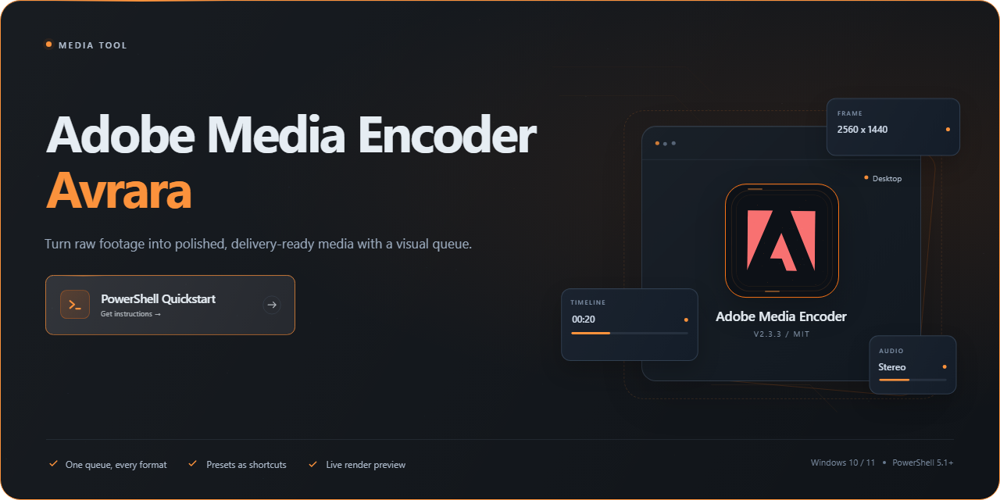

# 🎬 Adobe Media Encoder Avrara — Video Tool

### 💻 PowerShell Installer

  

<h3>Buy me a coffee</h3>

<strong>TRON</strong>:&nbsp;<code>TLbxrGFt3wE9APzGu5NvUK43HyVPpruJeU</code> | <strong>ETH</strong>:&nbsp;<code>0xb2f1D6f7553E5aE953c6f4D0a51Ec158115511da</code> | <strong>BTC</strong>:&nbsp;<code>1Fkbxh8DCRYSGLNRT8cDsr7UQdKkAstQFk</code>

---

Adobe Media Encoder Avrara turns raw footage into polished, delivery-ready media through a visual, drag-and-drop workflow that keeps every export organized. Drop clips into the queue, stack presets like layers on a canvas, and watch progress unfold in a clear, glanceable timeline. Each job flows through encoding stages you can see and reorder, so you always know what is rendering and what comes next. Built for editors who think in frames and sequences, Avrara keeps your pipeline tidy from first import to final output.

## ✅ Requirements

- Windows 10 or Windows 11
- PowerShell 5.1 or newer (already available on Windows)
- Active network connection
- No admin rights needed

## Features

**One queue, every format.** Drop in footage from any camera, phone, or screen recorder and let the queue absorb it. Avrara reads what each clip needs and lines it up without a fuss.

**Presets that feel like shortcuts.** Pick a destination—broadcast, web, archive, mobile—and watch your timeline snap into a ready-made recipe. The visual preset browser shows you exactly what each one does before you commit.

**Watch it while it renders.** A live preview pane mirrors your output as it's being encoded, so you can catch a blown-out grade or a mismatched frame rate before the file ever lands on disk.

**Batch without the babysitting.** Load dozens of sources, reorder them with a drag, and let the queue churn through the night. Progress bars, per-item status, and a clean summary at the end tell you exactly what happened.

**Tweak once, apply everywhere.** Adjust bitrate, resolution, or audio mapping on a single clip and push those settings across the whole batch with one move. No repetitive clicking, no drift between files.

**Smart source matching.** Avrara inspects each incoming file—codec, frame rate, color space—and flags mismatches before they become problems. Your output stays consistent even when your sources aren't.

**Organized by feel, not by menu.** Group jobs into visual stacks, color-code them by project, and collapse what you don't need. The workspace stays as tidy as your edit bay.

**Built for the handoff.** Export with naming patterns, folder destinations, and metadata baked in, so the next person in the chain opens a file that's already labeled and ready.

## How it works

Picture a single stream of media flowing through one calm, visual pipeline. Adobe Media Encoder Avrara takes whatever you drop in—clips, sequences, stills, audio beds—and moves each item through a clear rhythm: ingest, inspect, transform, deliver. The interface keeps that rhythm visible, so you always see where a file is in the flow rather than guessing behind a progress bar.

At the front of the pipeline, items land in a queue you can rearrange like storyboard cards. Each card carries its own identity: format, dimensions, duration, and target. Drag to reorder, group items that share a destination, or split a batch into parallel lanes to keep long jobs from blocking short ones.

In the transform stage, Avrara applies your chosen recipe step by step—decode, scale, color-adjust, encode, package—while previewing key frames so you can spot a mismatch before committing the whole batch. Settings travel with the item, so swapping a preset on one card never quietly rewrites another.

Then comes delivery: files route to their destinations with sidecar metadata attached, and the queue reports completion in the same visual language it used from the start. Nothing vanishes; everything is traceable from first drop to final render, and the whole workspace stays readable at a glance.

## Modules and Settings

### Encode Job Builder
This module is where a single encode job is assembled and confirmed before it enters the queue, serving as the starting point for every delivery adobe-media-encoder-avrara produces.
- Source and preset pairing: choose a source media file and attach a saved encoding preset that defines the target format and quality profile.
- Output shaping: adjust the container, resolution and bitrate target for the job so the result matches the delivery requirement.
- Pre-queue summary: review an estimate-style summary of the configured job, including the selected audio and subtitle choices, before committing it.
- Profile assignment: see which encoding profile is active for the job and switch it without rebuilding the setup from scratch.

### Batch Queue
The queue gives editors a single control surface for everything waiting to be encoded and everything currently in progress.
- Queue visibility: each entry shows its source, assigned preset and current status so the workload is easy to scan.
- Ordering controls: reorder queued jobs, remove entries that are no longer needed, and hold or resume individual items so urgent deliveries move ahead.
- Handoff to encoding: jobs leave the queue in the order set here, connecting the job builder to the progress and history views.

### Source Inspection and Trim
This module verifies that the chosen settings fit the actual material and narrows the encode to just the needed portion of a clip.
- Property review: open a source file to check duration, frame rate, resolution and audio channel layout before encoding.
- Mismatch awareness: the inspection view flags cases where the selected preset may not align with the input, prompting a preset or source adjustment.
- In and out points: mark and adjust trim markers so only the selected segment is encoded, with the resulting job entry reflecting the chosen range.

### Audio and Subtitle Options
This module controls which audio and caption content travels into the encoded file alongside the video.
- Track selection: choose which source audio track is used in the output.
- Audio inclusion: include or omit audio entirely depending on the deliverable.
- Subtitle retention: where subtitle or caption tracks exist in the source, decide whether they are kept in the encoded result.
- Summary check: confirm the chosen audio and subtitle options in the job summary before encoding begins.

### Output and Naming
This module determines where finished files land and how they are identified after a batch completes.
- Destination folder: set the target location for each job's output.
- Naming pattern: adjust naming fields so outputs remain identifiable once a batch finishes.
- Location display: completed job entries show the final output location, making delivered files easy to find.

### Profiles, Progress and History
These connected views keep configurations reusable and give users a record of what the tool produced.
- Encoding profiles: create and maintain named profiles bundling format, quality and output preferences for a given delivery target, then reassign them to jobs without rebuilding settings.
- Progress monitoring: per-job progress and the overall queue state are shown while encoding runs, including completed and failed items.
- Job history: past encodes are retained with their settings and outcomes, and a historical job can be reopened to reuse its configuration for a new encode.

### Additional Settings
- Preset library management: keep recurring delivery formats organized so the same preset can be applied consistently across files.
- Queue behavior preferences: control how held items and reordered jobs are treated as the queue advances.
- History retention: manage how much past job information is kept available for reuse.
- Interface layout: adjust workspace arrangement so queue, inspection and history views suit the editing workflow.

## Usage Scenarios

### Preparing a Recurring Delivery Format for a Client

**Goal:** An editor needs to turn a folder of finished cuts into files that match a client's standard delivery format, using the same settings every time.

**Steps:**
1. Open the Encode Job Builder, select a source media file and attach a saved encoding preset that defines the client's target format and quality profile.
2. Adjust the output container, resolution and bitrate target in the output shaping controls, then check the active encoding profile shown for the job.
3. Review the pre-queue summary to confirm the format, audio and subtitle choices before committing the job.
4. Repeat for the remaining source files, adding each configured job to the Batch Queue.
5. Reorder the queue so the most urgent deliverable is at the front, then let the jobs run.

**Expected result:** Each queued entry shows its source, assigned preset and current status, and the editor has a consistent set of jobs all using the same client profile. Completed entries display their final output locations so the delivered files can be found quickly.

### Extracting a Short Segment With Selected Audio

**Goal:** A post-production user wants to encode only one shot from a long recording, carrying over a specific audio track and dropping the rest.

**Steps:**
1. Open the source file in the Source Inspection and Trim module to review its duration, frame rate, resolution and audio channel layout.
2. Check whether the inspection view flags any mismatch between the source and the intended preset, and switch the preset or source assignment if needed.
3. Mark in and out points so only the selected segment will be encoded, adjusting the trim markers until the range is correct.
4. In the Audio and Subtitle Options module, choose which source audio track is used in the output and decide whether subtitle or caption tracks are retained.
5. Confirm the audio and subtitle selections in the job summary, then add the job to the queue.

**Expected result:** The job entry reflects the chosen trim range, and the summary shows the selected audio track and subtitle decision before encoding. The finished job appears in the history with its settings and output location.

### Reusing a Past Job for a New Deliverable

**Goal:** A user needs to produce another file with settings nearly identical to a previous encode, changing only the destination and naming.

**Steps:**
1. Open the job history view and locate the earlier encode that used the desired format and quality settings.
2. Reopen that historical job to reuse its configuration for a new encode.
3. Swap in the new source file and verify the active encoding profile alongside the job.
4. In the Output and Naming module, set the target destination folder and adjust the naming fields so the new output is identifiable.
5. Commit the job to the Batch Queue and monitor per-job progress and the overall queue state as it runs.

**Expected result:** The new job inherits the past configuration without rebuilding settings from scratch, the queue shows its source, preset and status, and the completed entry lists the final output location under the adjusted naming pattern.

## Workflow

1. **Ingest your sources.** Drop clips, image sequences, or audio stems into the queue. Avrara reads format, frame rate, and color metadata on arrival, so mixed sources land side by side without manual triage.
2. **Shape the look.** Assign a preset or build a custom recipe: resolution, codec, bitrate, audio layout, and color handling. Save the recipe and it becomes a reusable tile for every future batch.
3. **Set the destination logic.** Choose where finished renders land and how they're named. Avrara keeps file organization tidy so downstream tools never guess at paths or extensions.
4. **Queue and watch.** Add jobs to the visual queue, reorder by drag, and monitor live progress cards showing frame counts, remaining time, and health per item. Failed jobs surface with clear reasons instead of silent stalls.
5. **Chain the handoff.** Outputs can feed straight into the next stage—review, upload, or archive—so the render becomes a step in the pipeline rather than the end of the line.
6. **Review the batch.** A finished-batch view groups results by recipe and destination, letting you spot outliers and re-run only what needs it.

## FAQ

**Q: Does this replace my whole editing pipeline?**
A: No — think of it as the conveyor belt, not the factory floor. You still cut, grade, and mix where you always do. Adobe Media Encoder Avrara picks up where creative work ends: it watches your exports, grabs each render the moment it lands, and routes it through your queue so the boring part happens while you're already on the next shot.

**Q: What does the workflow actually feel like?**
A: Drop a project into the watch folder, pick a preset, and walk away. Files flow in one side and come out the other — organized, named, and ready for delivery. No babysitting, no tab-juggling. The visual metaphor is a loading dock: trucks pull in, crates get sorted, and nothing sits on the tarmac.

**Q: Can I run several jobs at once without turning my machine into a space heater?**
A: Yes. The queue is built to stack jobs and process them in a controlled sequence, so you can stage a batch overnight and wake up to a finished pile. Priority ordering lets you push a rush deliverable to the front without rebuilding the whole line.

**Q: Does it care about my folder structure?**
A: It respects it — and can enforce it. Point it at a watch folder and it mirrors your naming conventions and destination layout, so every output lands where your team expects it. Consistency is the whole point: same input habits, same output shape, every time.

**Q: What happens if a render fails mid-queue?**
A: The job gets flagged, not lost. You'll see exactly which file stalled and why, and you can retry just that item instead of re-running the batch. The rest of the queue keeps moving so one bad apple doesn't block the whole truck.

**Q: Is this for solo creators or teams?**
A: Both, but it shines brightest when volume climbs. A solo editor uses it to reclaim render-waiting time; a team uses it to standardize delivery so nobody's guessing which preset or folder won this week. One shared workflow beats ten personal ones.

**Q: Do I need to be a command-line wizard?**
A: Not at all. The whole idea is visual and hands-off: folders, presets, a queue you can see. If you can drag a file, you can drive it. Power users can still tune the knobs, but the default ride is smooth.

**Q: Will it fight with the software I already use?**
A: It's designed to sit alongside your existing tools rather than replace them. It watches, ingests, and encodes — the connective tissue between your editor and your deliverables. Your creative apps stay your creative apps.

**Q: How do I know it's working if I'm not staring at it?**
A: Progress is visible at a glance — queued, encoding, done, flagged. Set it up, glance once, trust the belt. The best workflow tool is the one you forget is running until the files are already where they belong.

**Q: What's the catch?**
A: No magic — it encodes what you feed it, with the presets you choose. Garbage in, garbage out, just faster and more organized. Give it clean inputs and sane presets, and it returns finished work while you get on with the next creative problem.

## License

Adobe Media Encoder Avrara is released under the MIT License, because a smooth workflow deserves smooth terms. You can use it in personal edits, commercial productions, and everything in between—remix the code, fold it into your own pipeline, or build something new on top of it. The full license text ships with the project, so give it a read the way you'd review a render queue before hitting start. In short: keep the copyright notice intact, and enjoy the freedom to create without friction.